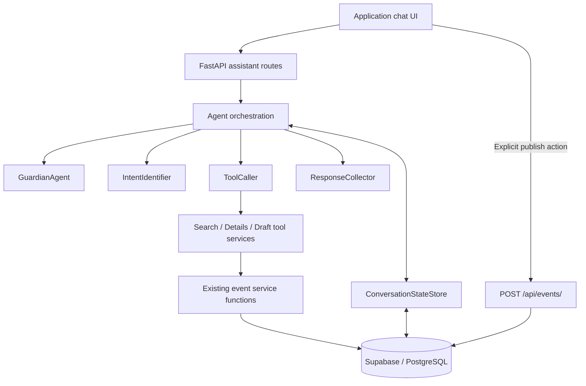
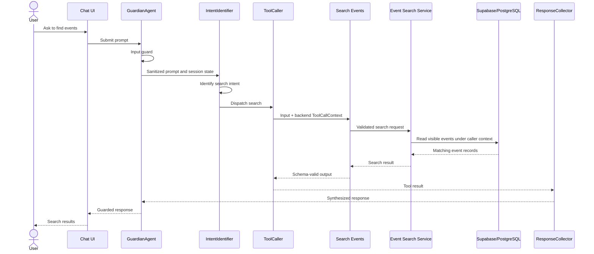
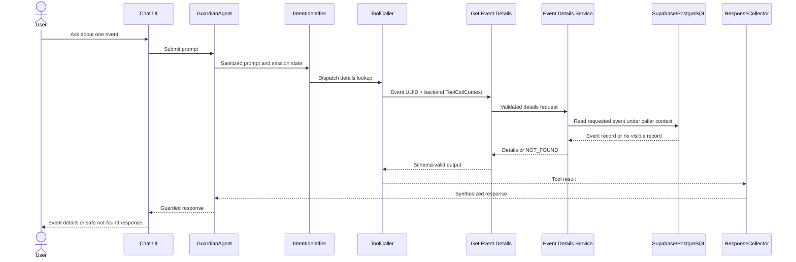
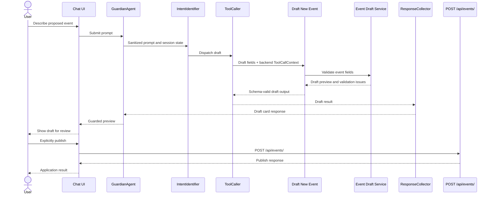

# Technical Design — Product Orientation Assistant


<!-- toc -->

- [1. Architecture Overview](#1-architecture-overview)
  - [1.1 Architectural Vision](#11-architectural-vision)
  - [1.2 Architecture Drivers](#12-architecture-drivers)
  - [1.3 Architecture Layers](#13-architecture-layers)
- [2. Principles & Constraints](#2-principles--constraints)
  - [2.1 Design Principles](#21-design-principles)
  - [2.2 Constraints](#22-constraints)
- [3. Technical Architecture](#3-technical-architecture)
  - [3.1 Domain Model](#31-domain-model)
  - [3.2 Component Model](#32-component-model)
  - [3.3 API Contracts](#33-api-contracts)
  - [3.4 Internal Dependencies](#34-internal-dependencies)
  - [3.5 External Dependencies](#35-external-dependencies)
  - [3.6 Interactions & Sequences](#36-interactions--sequences)
  - [3.7 Database schemas & tables](#37-database-schemas--tables)
- [4. Additional context](#4-additional-context)
  - [Architecture diagram reference](#architecture-diagram-reference)
  - [Security and Guardrails](#security-and-guardrails)
  - [Cross-tool Error Contract](#cross-tool-error-contract)
  - [Open Decisions Before Sign-off](#open-decisions-before-sign-off)
  - [Known Implementation Gaps](#known-implementation-gaps)
  - [Sign-off](#sign-off)
  - [Change log](#change-log)
- [5. Traceability](#5-traceability)
  - [Source acceptance criteria](#source-acceptance-criteria)
  - [Source references](#source-references)

<!-- /toc -->

- **Status:** DRAFT - revised, ready for sign-off review
- **Version:** 0.2
- **Scope:** The three tools available to the product-orientation chat assistant
- **Owner:** Product team
- **Last updated:** 2026-10-12
- **Source specification:** `docs/agent-tool-specification.md` (restructured; technical content retained)
## 1. Architecture Overview

### 1.1 Architectural Vision

The product-orientation assistant helps users understand and use the events product through chat. It supports three tool-backed capabilities: searching for events, retrieving the details of one event, and drafting a new event. General product FAQs and navigation guidance can be answered without a tool; ambiguous requests are routed to clarification.

The architecture separates conversational orchestration from authoritative event operations. The assistant uses backend tools and services for event data and must not claim that an event exists, has changed, or has been published unless the corresponding tool response confirms it. Tool calls execute on behalf of one authenticated user, with caller identity supplied by backend context rather than model-generated input.

Event creation remains human-in-the-loop. The Draft New Event tool returns a preview and validation issues but does not persist or publish an event. The user reviews the draft in the application interface and explicitly invokes `POST /api/events/` to create it. Conversation state and agent telemetry are persisted in Supabase/PostgreSQL; the source design specifies no Redis cache.

### 1.2 Architecture Drivers

The architecture is driven by the three assistant capabilities, authenticated per-user access, event visibility rules, schema-valid tool contracts, safe draft behavior, and traceable conversation orchestration.

**ADRs:**

- `cpt-eventbackend-adr-database-migration-ordering` — Database migration ordering strategy.
- `cpt-eventbackend-adr-suspension-protection-and-cancellation-reasons` — Suspension protection and cancellation-reason handling.
- `cpt-eventbackend-adr-caller-identity-blocking` — Caller identity and blocking visibility.

These ADRs document decisions relevant to the architecture drivers and should be reviewed alongside this design before sign-off.

#### Functional Drivers

| Requirement | Design Response |
|-------------|------------------|
| `FR-SEARCH-001` to `FR-SEARCH-010` | Search Events accepts free text and discovery filters, requires a meaningful criterion, validates dates and pagination, returns visible events only, and uses deterministic ordering. |
| `FR-DETAIL-001` to `FR-DETAIL-007` | Get Event Details accepts one UUID and returns the authoritative visible event record; missing and hidden events share `NOT_FOUND`. |
| `FR-DRAFT-001` to `FR-DRAFT-010` | Draft New Event validates a proposed event and returns a preview; it does not persist, publish, notify participants, or add a participant. |
| Caller identity and authorization rules in the Common Tool Contract | Backend-created `ToolCallContext` supplies the verified caller; tool input cannot supply identity or permission fields. |
| Agent intent routing and conversational workflow | `GuardianAgent`, `IntentIdentifier`, `ToolCaller`, `ResponseCollector`, and `ConversationStateStore` coordinate guardrails, routing, tool execution, response synthesis, and session state. |
| Conversation persistence and telemetry | Supabase-backed `ai_conversations`, `ai_messages`, and `ai_agent_audit_logs` store sessions, user-facing messages, and agent actions. |

#### NFR Allocation

The source specification does not define named non-functional requirements (NFR IDs), target values, or verification thresholds. The following quality-related rules are explicitly stated in the source; they are not substitutes for a PRD NFR allocation.

| NFR ID | NFR Summary | Allocated To | Design Response | Verification Approach |
|--------|-------------|--------------|-----------------|----------------------|
| Not specified | Confidentiality and credential protection | Tool context, Supabase access, audit logging, GuardianAgent | Never expose or log `access_token`; do not use `SUPABASE_SERVICE_KEY` in tool services; do not expose internal errors or unrestricted personal data. | Verify implementation and audit payloads against the security rules and known implementation gaps. |
| Not specified | Input and output integrity | Tool schemas and service validation | Validate JSON Schema draft 2020-12 with format checking; repeat service-level validation with Pydantic; enforce mutually exclusive success/error states. | Run `tests/test_agent_tool_spec_schemas.py` and service validation tests. |
| Not specified | Availability/error handling | Tool services | Return the closed error-code set and structured errors; use `SERVICE_UNAVAILABLE` for temporary service/database failures. | Exercise tool failure paths and validate output schemas. |
| Not specified | Traceability | Tool calls and orchestration | Return stable `request_id`; record agent actions and tool invocations in `ai_agent_audit_logs`. | Inspect audit records and request correlation. |

### 1.3 Architecture Layers

The following is a logical layering derived from the components and paths named in the source specification. The source does not define a deployment topology or frontend technology.



| Layer | Responsibility | Technology |
|-------|---------------|------------|
| Presentation | Chat interface; displays conversation history, search results, and draft preview cards; user explicitly triggers publish. | Frontend technology is not specified in this source. |
| Application | Assistant request handling, agent orchestration, tool dispatch, response synthesis, and publish route. | FastAPI; Pydantic state object is referenced. |
| Domain | Event search, event details, event draft validation, and existing event business logic. | Python service modules named in the source. |
| Infrastructure | Authentication context, row-level security, conversation persistence, messages, and audit telemetry. | Supabase and PostgreSQL; JWT; no Redis. |

## 2. Principles & Constraints

### 2.1 Design Principles

#### Authoritative tool data

- [ ] `p2` - **ID**: `cpt-eventbackend-principle-authoritative-tool-data`

The assistant uses tools for authoritative event data. It must not claim that an event exists, has changed, or has been published unless the corresponding tool response confirms it.

#### Backend-owned caller identity

- [ ] `p2` - **ID**: `cpt-eventbackend-principle-backend-owned-identity`

Caller identity and permission context are created by the backend from the verified Supabase JWT. The language model cannot create, see, or change `ToolCallContext`, and tool input schemas reject additional identity or permission properties.

#### Fail-closed event visibility

- [ ] `p2` - **ID**: `cpt-eventbackend-principle-fail-closed-visibility`

Only active events whose `end_datetime` is now or in the future are visible to the assistant. Missing and hidden events produce the same `NOT_FOUND` response. Any future private or restricted visibility level remains hidden by default until this design is revised and signed off.

#### Human-in-the-loop event creation

- [ ] `p2` - **ID**: `cpt-eventbackend-principle-human-confirmed-publish`

Drafting is preview-only. The agent does not persist, publish, modify events, notify participants, or add the creator as a participant. Event creation occurs only after the user explicitly invokes the application publish action.

#### Reuse existing backend business logic

- [ ] `p2` - **ID**: `cpt-eventbackend-principle-reuse-backend-services`

Tool implementations wrap existing audited FastAPI endpoints and backend service functions rather than reimplementing business logic, so existing RLS, validation, coordinate checks, and rate limits remain applicable.

#### Auditable orchestration

- [ ] `p2` - **ID**: `cpt-eventbackend-principle-auditable-orchestration`

Agent actions, tool invocations, and guardrail checks are recorded in `ai_agent_audit_logs`. Audit payloads may include `user_id` and tool inputs/outputs but must never include `access_token` or other credentials.

### 2.2 Constraints

#### Authenticated per-user execution

- [ ] `p2` - **ID**: `cpt-eventbackend-constraint-authenticated-user-context`

Every tool call requires exactly one signed-in user. A missing context or empty `user_id` returns `UNAUTHORIZED` before reading data. Tool services must use a per-request Supabase client created with the anon key and the caller's JWT so RLS applies. Tool services must never use `SUPABASE_SERVICE_KEY`.

#### No direct agent database access

- [ ] `p2` - **ID**: `cpt-eventbackend-constraint-no-agent-db-access`

The agent has no direct database connection string, network route, or permission to execute raw PostgreSQL/Supabase queries.

#### Restricted tool input surface

- [ ] `p2` - **ID**: `cpt-eventbackend-constraint-closed-tool-input`

Tool input schemas use `"additionalProperties": false`. The model cannot pass `user_id`, `created_by`, `status`, or other identity/permission fields. The user's role, including `administrator`, grants no extra assistant access; administrative work remains in the admin panel.

#### Event visibility boundary

- [ ] `p2` - **ID**: `cpt-eventbackend-constraint-event-visibility`

Assistant-visible events must have `status = 'active'` and `end_datetime` now or in the future. Cancelled, ended, and future restricted events are not visible. Missing and hidden event lookups return the same `NOT_FOUND` code and message.

#### Draft and publish boundary

- [ ] `p2` - **ID**: `cpt-eventbackend-constraint-draft-preview-only`

Draft New Event requires a signed-in, onboarded caller, returns a preview and validation issues, and performs no persistence or publication. The user must explicitly publish through `POST /api/events/`.

#### Data and credential disclosure boundary

- [ ] `p2` - **ID**: `cpt-eventbackend-constraint-no-credential-disclosure`

Tool calls and responses must not expose service-role credentials, internal database errors, or unrestricted personal data. Error messages must not contain stack traces, SQL, table names, tokens, or other users' data. Access tokens are never logged or placed in model context.

## 3. Technical Architecture

### 3.1 Domain Model

The source specification describes the following domain concepts and data structures. It does not provide a separate canonical domain-model file or complete physical schema for the `events` table.

**Technology:** Python/Pydantic models, JSON Schema draft 2020-12, Supabase/PostgreSQL.

**Location:** Tool service and schema paths are listed under API Contracts and Known Implementation Gaps. A standalone domain-model file is not identified in the source.

**Core Entities:**

| Entity | Description | Schema / Source |
|--------|-------------|-----------------|
| Event | Event record returned by Search Events and Get Event Details; includes UUID, title, descriptive fields, timing, location, cost/capacity, and active status. | `EventSummary`, `EventDetails` JSON Schema definitions in API Contracts. |
| ToolCallContext | Backend-created identity and request context for one tool call: `user_id`, `access_token`, `is_onboarded`, and `request_id`. | Common Tool Contract. |
| DraftPreview | Non-persisted proposed event returned to the user for review. | `DraftPreview` JSON Schema definition in API Contracts. |
| ValidationIssue | Draft validation result with code, field, message, and `error`/`warning` severity. | `ValidationIssue` JSON Schema definition in API Contracts. |
| Conversation | A user-owned assistant chat session with `context_state` and timestamps. | `ai_conversations` table. |
| Message | User-facing conversation message with role, content, metadata, and timestamp. | `ai_messages` table. |
| Agent Audit Log | Agent action/tool telemetry associated with a conversation and optionally a message/user. | `ai_agent_audit_logs` table. |

**Relationships:**
- A user owns conversations through `ai_conversations.user_id`.
- A conversation contains messages through `ai_messages.conversation_id`.
- A conversation has agent audit entries through `ai_agent_audit_logs.conversation_id`.
- An audit entry may reference a message through `message_id`.
- Draft previews are not stored as events; they are returned to the requesting user in the same conversation.
- Event creator identity is returned as `created_by` when available in event details; the source does not define the full event-table relationship model.

### 3.2 Component Model

The assistant architecture consists of four specialized agents, a Supabase-backed conversation state store, three tool capabilities, and existing backend event services. The source describes the orchestration and persistence responsibilities below. Component IDs are assigned using the registered system slug `eventbackend` and the SDLC DESIGN identifier convention.

#### Guardian Agent

- [ ] `p2` - **ID**: `cpt-eventbackend-component-guardian-agent`

##### Why this component exists

The orchestration needs input and output guardrails to intercept malicious or irrelevant instructions and prevent disclosure of internal errors, secrets, or sensitive system details.

##### Responsibility scope

Screens user prompts for prompt injection, jailbreaks, system-instruction exfiltration attempts, and off-topic requests before downstream processing. Verifies final responses for internal errors, secrets, PII, access tokens, and prompt templates.

##### Responsibility boundaries

Does not replace backend authentication, authorization, RLS, schema validation, or service-level validation. The source specifies guardrail behavior but does not define its model, implementation library, or deployment boundary.

##### Related components (by ID)

- `cpt-eventbackend-component-intent-identifier` — receives sanitized prompts and session context.
- `cpt-eventbackend-component-response-collector` — final response is subject to output checking.
- `cpt-eventbackend-component-conversation-state-store` — guardrail checks are recorded in audit telemetry.

#### Intent Identifier

- [ ] `p2` - **ID**: `cpt-eventbackend-component-intent-identifier`

##### Why this component exists

The assistant must distinguish requests requiring event tools from general product questions and ambiguous requests that need clarification.

##### Responsibility scope

Analyzes the sanitized user prompt and session state to classify intent as tool calling, normal LLM response (FAQ/navigation guidance), or more-information asking.

##### Responsibility boundaries

Does not execute backend tools; tool execution is delegated to `ToolCaller`. It does not bypass the requirement to clarify ambiguous searches.

##### Related components (by ID)

- `cpt-eventbackend-component-guardian-agent` — receives sanitized input.
- `cpt-eventbackend-component-tool-caller` — receives tool-call intent.
- `cpt-eventbackend-component-response-collector` — may provide direct FAQ/clarification responses.
- `cpt-eventbackend-component-conversation-state-store` — uses shared session state.

#### Tool Caller

- [ ] `p2` - **ID**: `cpt-eventbackend-component-tool-caller`

##### Why this component exists

Tool execution is separated from intent classification and response synthesis so that the assistant's event operations pass through defined backend tool contracts.

##### Responsibility scope

Dispatches and executes Search Events, Get Event Details, or Draft New Event against backend service functions. Tool calls use the backend-created `ToolCallContext` and the input/output schemas defined in API Contracts.

##### Responsibility boundaries

Does not directly query PostgreSQL/Supabase, use `SUPABASE_SERVICE_KEY`, create caller identity from model output, or persist/publish drafted events. It delegates business logic to existing backend services.

##### Related components (by ID)

- `cpt-eventbackend-component-intent-identifier` — provides classified tool intent.
- `cpt-eventbackend-component-search-events-tool` — search capability.
- `cpt-eventbackend-component-get-event-details-tool` — detail capability.
- `cpt-eventbackend-component-draft-new-event-tool` — draft capability.
- `cpt-eventbackend-component-conversation-state-store` — action and tool telemetry is persisted.

#### Response Collector

- [ ] `p2` - **ID**: `cpt-eventbackend-component-response-collector`

##### Why this component exists

Tool results, FAQ responses, and clarification responses need to be synthesized into user-facing conversational output.

##### Responsibility scope

Collects ToolCaller output or direct IntentIdentifier responses, synthesizes a helpful response, and presents draft cards to the user for human-in-the-loop publishing.

##### Responsibility boundaries

Does not treat unconfirmed tool results as authoritative, modify event data, or publish a draft. The source does not define a specific response-rendering technology.

##### Related components (by ID)

- `cpt-eventbackend-component-tool-caller` — provides tool results.
- `cpt-eventbackend-component-intent-identifier` — provides FAQ/clarification responses.
- `cpt-eventbackend-component-guardian-agent` — output guardrail.
- `cpt-eventbackend-component-conversation-state-store` — conversation and action records.

#### Conversation State Store

- [ ] `p2` - **ID**: `cpt-eventbackend-component-conversation-state-store`

##### Why this component exists

All conversational turns, extracted entity slots, tool outputs, and agent telemetry must remain synchronized across the chat lifecycle.

##### Responsibility scope

Uses Supabase-backed persistence (no Redis) for conversation lifecycle and agent scratchpads. Loads the session record, `context_state`, and recent dialogue into a structured Pydantic state object (`agent_context_json`). During orchestration, each agent has a `context_data` array containing previous text messages in the conversation (for example, `[{"role": "user", "content": "..."}, {"role": "assistant", "content": "..."}]`). Provides shared context and multi-turn message history to agents. Records discrete agent actions, tool invocations, and guardrail checks in Supabase tables.

##### Responsibility boundaries

Does not store access tokens in `ai_agent_audit_logs` or model context. The source does not specify a separate cache service or a detailed concurrency/retention policy.

##### Related components (by ID)

- `cpt-eventbackend-component-guardian-agent` — guardrail audit events.
- `cpt-eventbackend-component-intent-identifier` — session context.
- `cpt-eventbackend-component-tool-caller` — tool invocation records.
- `cpt-eventbackend-component-response-collector` — conversation state and message history.
- `cpt-eventbackend-component-search-events-tool` — request/action telemetry.
- `cpt-eventbackend-component-get-event-details-tool` — request/action telemetry.
- `cpt-eventbackend-component-draft-new-event-tool` — request/action telemetry.

#### Search Events Tool

- [ ] `p2` - **ID**: `cpt-eventbackend-component-search-events-tool`

##### Why this component exists

The assistant needs a constrained capability to discover events using meaningful search criteria and supported discovery filters.

##### Responsibility scope

Accepts free-text query and optional category, upcoming, date, and city filters; validates pagination; returns visible event summaries and pagination metadata; applies deterministic ordering; returns an empty successful result when no events match.

##### Responsibility boundaries

Does not return events outside the visibility policy, accept unconstrained searches, or determine caller identity from tool input. It does not implement event business logic independently of the existing backend services.

##### Related components (by ID)

- `cpt-eventbackend-component-tool-caller` — dispatches the tool.
- `cpt-eventbackend-component-conversation-state-store` — records invocation telemetry.
- `cpt-eventbackend-component-get-event-details-tool` — detail follow-up when summary data is insufficient.

#### Get Event Details Tool

- [ ] `p2` - **ID**: `cpt-eventbackend-component-get-event-details-tool`

##### Why this component exists

The assistant needs authoritative detail for one event when search summaries do not contain enough information to answer a detailed question.

##### Responsibility scope

Accepts exactly one UUID and returns the current authoritative record for a visible event, including the defined event fields and nullable values.

##### Responsibility boundaries

Does not reveal whether a missing or hidden event exists. It returns the same `NOT_FOUND` code and message for missing, ended, cancelled, or future restricted events.

##### Related components (by ID)

- `cpt-eventbackend-component-tool-caller` — dispatches the tool.
- `cpt-eventbackend-component-search-events-tool` — supplies event identifiers from search results.
- `cpt-eventbackend-component-conversation-state-store` — records invocation telemetry.

#### Draft New Event Tool

- [ ] `p2` - **ID**: `cpt-eventbackend-component-draft-new-event-tool`

##### Why this component exists

The assistant needs to help a user formulate a new event while keeping validation and final publication under backend and user control.

##### Responsibility scope

Accepts event fields, validates required fields, date ordering, timezone, cost, capacity, and coordinates, and returns a draft preview with validation issues.

##### Responsibility boundaries

Does not persist, publish, notify participants, add the creator as a participant, silently replace invalid/missing values, or read event data from the database. The user's explicit application publish action creates the event.

##### Related components (by ID)

- `cpt-eventbackend-component-tool-caller` — dispatches the tool.
- `cpt-eventbackend-component-response-collector` — presents the draft preview.
- `cpt-eventbackend-component-conversation-state-store` — records invocation telemetry.
- `cpt-eventbackend-component-publish-endpoint` — user-triggered publish path, not an agent tool.

#### Event Publish Endpoint

- [ ] `p2` - **ID**: `cpt-eventbackend-component-publish-endpoint`

##### Why this component exists

A draft becomes an event only after the user reviews the preview and explicitly triggers the application's publish method.

##### Responsibility scope

The source identifies `POST /api/events/` as the user-triggered event creation endpoint and states that it requires a signed-in, onboarded user through `get_current_onboarded_user`.

##### Responsibility boundaries

This endpoint is not one of the three assistant tools. The agent cannot invoke it autonomously or treat a draft preview as a published event. The source does not document the full endpoint request/response schema here.

##### Related components (by ID)

- `cpt-eventbackend-component-draft-new-event-tool` — provides the preview shown to the user.
- `cpt-eventbackend-component-response-collector` — presents the draft card for review.

### 3.3 API Contracts

The three assistant tools have JSON input and output schemas. Every tool call has a stable `request_id`, a `success` boolean, and an `error` field that is `null` on success and an `Error` object on failure. The full source schemas are retained below.

#### Common Tool Contract

##### 2.1 Input and output rules

Every tool call has:

- A JSON input object that validates against the tool's input schema.
- A JSON output object that validates against the tool's output schema.
- A stable `request_id` for tracing the call.
- A `success` boolean.
- An `error` field that is `null` when `success` is `true`, and an `Error` object when `success` is `false`. The schemas enforce this with `if`/`then`/`else`; a response that breaks this rule is invalid.

Dates and times use ISO 8601 strings with an explicit timezone offset or `Z`. Event identifiers are UUID strings.

Tool calls must not expose service-role credentials, internal database errors, or unrestricted personal data.

**Schema validation rule.** In JSON Schema draft 2020-12, the `format` keyword is only a note by default and is not checked. Every validator used for these schemas (tests, the agent runtime, CI) must turn on format checking (for example `format_checker=Draft202012Validator.FORMAT_CHECKER` in the Python `jsonschema` package). The services must also run their own checks (Pydantic models), because a regular expression alone cannot reject dates such as `2026-02-30`.

##### 2.2 Caller identity context

Every tool call runs on behalf of exactly one signed-in user. The backend builds a `ToolCallContext` for each call. This context is **not** part of the tool input, and the language model can never create, see, or change it.

| Field | Type | Source | Rules |
|---|---|---|---|
| `user_id` | UUID string | The `sub` claim of the Supabase JWT that was verified on the `/api/assistant/*` request (`get_current_user`). | Required for every tool. Never taken from model output or chat text. |
| `access_token` | string | The same bearer token from the request. | Used only to create a per-request Supabase client with the anon key, so database row-level security (RLS) applies as that user. Never logged, never written to `ai_agent_audit_logs`, never put in model context. |
| `is_onboarded` | boolean | The same check used by `get_current_onboarded_user`. | Used by the Draft tool only. |
| `request_id` | string | Created by the backend per tool call. | Returned in the tool output. |

Rules:

1. If `ToolCallContext` is missing, or `user_id` is empty, the tool returns `UNAUTHORIZED` and reads no data.
2. Tool input schemas use `"additionalProperties": false`, so the model cannot pass `user_id`, `created_by`, `status`, or any other identity or permission field.
3. The user's role (including `administrator`) gives no extra access through the assistant. Admin work happens only in the admin panel.
4. Tool services never use `SUPABASE_SERVICE_KEY`.

##### 2.3 Event visibility policy

The data model today has no private, invite-only, or friends-only events: the `events` table has no visibility column, and its RLS read policy allows everyone (`USING (true)`). Event `status` is either `active` or `cancelled`.

An event is **visible to the assistant** only when both are true:

- `status = 'active'`, and
- `end_datetime` is now or in the future.

| Visibility level | Exists today? | Assistant access |
|---|---|---|
| Active and not yet ended | Yes | Search and Get Event Details |
| Active but already ended | Yes | Not visible. Details returns `NOT_FOUND`. |
| Cancelled | Yes | Not visible. Details returns `NOT_FOUND`. |
| Private, invite-only, friends-only | No | Not visible. If such levels are added later, the tools must hide them by default (fail closed) until this specification is revised and signed off again. |
| Draft previews | Not stored | Returned only to the user who asked for them, in the same conversation. |

##### 2.4 Per-tool authorization

| Tool | Signed in | Onboarded | What it can read | Failure codes it may return |
|---|---|---|---|---|
| Search Events | Required | Not required | Visible events only (Section 2.3) | `UNAUTHORIZED`, `INVALID_INPUT`, `SERVICE_UNAVAILABLE`, `INTERNAL_ERROR` |
| Get Event Details | Required | Not required | One visible event | `UNAUTHORIZED`, `INVALID_INPUT`, `NOT_FOUND`, `SERVICE_UNAVAILABLE`, `INTERNAL_ERROR` |
| Draft New Event | Required | Required (same rule as `POST /api/events/`, because a user who cannot publish should not get a draft they cannot use) | Nothing from the database | `UNAUTHORIZED`, `FORBIDDEN`, `INVALID_INPUT`, `INTERNAL_ERROR` |

##### 2.5 Access error behavior

- **Not signed in, or token invalid or expired:** `UNAUTHORIZED`. The assistant tells the user to sign in again. It does not retry with other credentials.
- **Signed in but not onboarded (Draft only):** `FORBIDDEN`. The assistant tells the user to finish their profile first.
- **Event does not exist, or exists but is not visible:** `NOT_FOUND` with the same message (`"Event not found."`) in both cases, so the response does not confirm that a hidden event exists. `FORBIDDEN` is never used for event visibility.
- Error messages never include stack traces, SQL, table names, tokens, or other users' data.

#### Search Events

##### 3.1 Functional requirements

- **FR-SEARCH-001:** Accept a free-text search query and optional event filters.
- **FR-SEARCH-002:** Support the product's current discovery filters: category, upcoming status, date, and city (matched against `location_name`).
- **FR-SEARCH-003:** Support pagination with a positive page number, bounded page size, total record count, and `has_next` calculation.
- **FR-SEARCH-004:** Return only events visible under Section 2.3, for a signed-in caller (Section 2.4).
- **FR-SEARCH-005:** Return enough summary data for the assistant to explain and compare results without requiring a detail call for every result.
- **FR-SEARCH-006:** Return an empty result set with `success: true` when no events match; this is not an error.
- **FR-SEARCH-007:** Apply deterministic ordering. The initial default is upcoming events ordered by start time ascending, followed by a stable identifier as a tie-breaker.
- **FR-SEARCH-008:** Reject invalid pagination or filter values with a structured validation error. A `date` must be a real calendar date (for example, `2026-02-30` and `2026-99-99` are rejected).
- **FR-SEARCH-009:** The assistant should ask a clarifying question when the user's request is too ambiguous to form a useful search, rather than issuing an unconstrained search.
- **FR-SEARCH-010:** The tool must reject a search without at least one meaningful criterion: a non-empty, non-whitespace value for `query`, `category`, `date`, or `city`. `upcoming`, `page`, and `limit` alone do not count. Inputs such as `{}`, `{"query": null}`, and `{"query": "   "}` return `INVALID_INPUT`. This enforces FR-SEARCH-009 at the tool level, so a model that skips the clarifying question still cannot run an unconstrained search.

##### 3.2 Input schema

```json
{
  "$schema": "https://json-schema.org/draft/2020-12/schema",
  "title": "SearchEventsInput",
  "type": "object",
  "additionalProperties": false,
  "properties": {
    "query": {
      "type": ["string", "null"],
      "description": "Free-text terms matched against event title and description.",
      "minLength": 1,
      "maxLength": 200
    },
    "category": {
      "type": ["string", "null"],
      "minLength": 1,
      "maxLength": 100
    },
    "upcoming": {
      "type": "boolean",
      "default": true
    },
    "date": {
      "type": ["string", "null"],
      "description": "Calendar date in YYYY-MM-DD format. Must be a real date.",
      "format": "date",
      "pattern": "^[0-9]{4}-(0[1-9]|1[0-2])-(0[1-9]|[12][0-9]|3[01])$"
    },
    "city": {
      "type": ["string", "null"],
      "description": "City or locality name matched against event location_name.",
      "minLength": 1,
      "maxLength": 120
    },
    "page": {
      "type": "integer",
      "minimum": 1,
      "default": 1
    },
    "limit": {
      "type": "integer",
      "minimum": 1,
      "maximum": 50,
      "default": 10
    }
  },
  "anyOf": [
    { "required": ["query"], "properties": { "query": { "type": "string", "pattern": "\\S" } } },
    { "required": ["category"], "properties": { "category": { "type": "string", "pattern": "\\S" } } },
    { "required": ["date"], "properties": { "date": { "type": "string" } } },
    { "required": ["city"], "properties": { "city": { "type": "string", "pattern": "\\S" } } }
  ]
}
```

The `anyOf` block is what rejects empty and unconstrained searches: at least one of `query`, `category`, `date`, or `city` must be present as a string with at least one non-space character. A `null` value does not count.

##### 3.3 Output schema

```json
{
  "$schema": "https://json-schema.org/draft/2020-12/schema",
  "title": "SearchEventsOutput",
  "type": "object",
  "additionalProperties": false,
  "required": ["request_id", "success", "events", "pagination", "error"],
  "properties": {
    "request_id": { "type": "string", "minLength": 1 },
    "success": { "type": "boolean" },
    "events": {
      "type": "array",
      "items": { "$ref": "#/$defs/EventSummary" }
    },
    "pagination": {
      "type": "object",
      "additionalProperties": false,
      "required": ["page", "limit", "total", "has_next"],
      "properties": {
        "page": { "type": "integer", "minimum": 1 },
        "limit": { "type": "integer", "minimum": 1, "maximum": 50 },
        "total": { "type": "integer", "minimum": 0 },
        "has_next": { "type": "boolean" }
      }
    },
    "error": {
      "oneOf": [{ "type": "null" }, { "$ref": "#/$defs/Error" }]
    }
  },
  "if": {
    "required": ["success"],
    "properties": { "success": { "const": true } }
  },
  "then": {
    "properties": { "error": { "type": "null" } }
  },
  "else": {
    "properties": {
      "error": { "$ref": "#/$defs/Error" },
      "events": { "maxItems": 0 },
      "pagination": {
        "properties": {
          "total": { "const": 0 },
          "has_next": { "const": false }
        }
      }
    }
  },
  "$defs": {
    "EventSummary": {
      "type": "object",
      "additionalProperties": false,
      "required": ["id", "title", "start_datetime", "status"],
      "properties": {
        "id": { "type": "string", "format": "uuid" },
        "title": { "type": "string", "minLength": 1 },
        "description": { "type": ["string", "null"] },
        "category": { "type": ["string", "null"] },
        "start_datetime": { "type": "string", "format": "date-time" },
        "end_datetime": { "type": ["string", "null"], "format": "date-time" },
        "location_name": { "type": ["string", "null"] },
        "cost": { "type": ["number", "null"], "minimum": 0 },
        "max_capacity": { "type": ["integer", "null"], "minimum": 1 },
        "status": { "const": "active" }
      }
    },
    "Error": {
      "type": "object",
      "additionalProperties": false,
      "required": ["code", "message", "field"],
      "properties": {
        "code": {
          "enum": ["INVALID_INPUT", "NOT_FOUND", "UNAUTHORIZED", "FORBIDDEN", "SERVICE_UNAVAILABLE", "INTERNAL_ERROR"]
        },
        "message": { "type": "string", "minLength": 1 },
        "field": { "type": ["string", "null"] }
      }
    }
  }
}
```

On failure, `events` must be empty and `pagination` must report `total: 0` and `has_next: false`. `status` is fixed to `active` because only visible events may be returned (Section 2.3).

#### Get Event Details

##### 4.1 Functional requirements

- **FR-DETAIL-001:** Accept exactly one event identifier, which must be a UUID.
- **FR-DETAIL-002:** Return the current authoritative event record when the event exists and is visible under Section 2.3.
- **FR-DETAIL-003:** Return the event's identity, description, category, timing, location, cost, capacity, status, and creator reference when available.
- **FR-DETAIL-004:** Return `NOT_FOUND` when the identifier does not refer to a visible event. Missing events and hidden events (cancelled, ended, or any future restricted level) get the same code and message (Section 2.5).
- **FR-DETAIL-005:** Never invent missing event fields. Optional or unavailable values must be returned as `null`.
- **FR-DETAIL-006:** The assistant should use this tool before answering detailed questions about one event when the search result does not contain enough information.
- **FR-DETAIL-007:** Require a signed-in caller (Section 2.4). Without one, return `UNAUTHORIZED` before reading any data.

##### 4.2 Input schema

```json
{
  "$schema": "https://json-schema.org/draft/2020-12/schema",
  "title": "GetEventDetailsInput",
  "type": "object",
  "additionalProperties": false,
  "required": ["event_id"],
  "properties": {
    "event_id": {
      "type": "string",
      "description": "The event identifier returned by Search Events.",
      "format": "uuid",
      "pattern": "^[0-9a-fA-F]{8}-[0-9a-fA-F]{4}-[0-9a-fA-F]{4}-[0-9a-fA-F]{4}-[0-9a-fA-F]{12}$"
    }
  }
}
```

##### 4.3 Output schema

```json
{
  "$schema": "https://json-schema.org/draft/2020-12/schema",
  "title": "GetEventDetailsOutput",
  "type": "object",
  "additionalProperties": false,
  "required": ["request_id", "success", "event", "error"],
  "properties": {
    "request_id": { "type": "string", "minLength": 1 },
    "success": { "type": "boolean" },
    "event": {
      "oneOf": [{ "type": "null" }, { "$ref": "#/$defs/EventDetails" }]
    },
    "error": {
      "oneOf": [{ "type": "null" }, { "$ref": "#/$defs/Error" }]
    }
  },
  "if": {
    "required": ["success"],
    "properties": { "success": { "const": true } }
  },
  "then": {
    "properties": {
      "event": { "$ref": "#/$defs/EventDetails" },
      "error": { "type": "null" }
    }
  },
  "else": {
    "properties": {
      "event": { "type": "null" },
      "error": { "$ref": "#/$defs/Error" }
    }
  },
  "$defs": {
    "EventDetails": {
      "type": "object",
      "additionalProperties": false,
      "required": [
        "id", "title", "description", "category", "cost", "max_capacity",
        "start_datetime", "end_datetime", "location_name", "latitude",
        "longitude", "created_by", "status"
      ],
      "properties": {
        "id": { "type": "string", "format": "uuid" },
        "title": { "type": "string", "minLength": 1 },
        "description": { "type": ["string", "null"] },
        "category": { "type": ["string", "null"] },
        "cost": { "type": ["number", "null"], "minimum": 0 },
        "max_capacity": { "type": ["integer", "null"], "minimum": 1 },
        "start_datetime": { "type": "string", "format": "date-time" },
        "end_datetime": { "type": "string", "format": "date-time" },
        "location_name": { "type": ["string", "null"] },
        "latitude": { "type": ["number", "null"], "minimum": -90, "maximum": 90 },
        "longitude": { "type": ["number", "null"], "minimum": -180, "maximum": 180 },
        "created_by": { "type": ["string", "null"] },
        "status": { "const": "active" }
      }
    },
    "Error": {
      "type": "object",
      "additionalProperties": false,
      "required": ["code", "message", "field"],
      "properties": {
        "code": {
          "enum": ["INVALID_INPUT", "NOT_FOUND", "UNAUTHORIZED", "FORBIDDEN", "SERVICE_UNAVAILABLE", "INTERNAL_ERROR"]
        },
        "message": { "type": "string", "minLength": 1 },
        "field": { "type": ["string", "null"] }
      }
    }
  }
}
```

All event keys are always present; unknown values are `null` (FR-DETAIL-005).

#### Draft New Event

##### 5.1 Functional requirements

- **FR-DRAFT-001:** Accept the fields required to describe a new event and optional fields supported by the product.
- **FR-DRAFT-002:** Require `title`, `start_datetime`, and `end_datetime`.
- **FR-DRAFT-003:** Validate that the end is later than the start, cost is non-negative, capacity is positive when supplied, and coordinates are within valid geographic bounds.
- **FR-DRAFT-004:** Normalize dates to ISO 8601 and preserve the supplied timezone information. A date-time without a timezone offset or `Z` is rejected.
- **FR-DRAFT-005:** Return a draft preview and a list of validation issues, if any.
- **FR-DRAFT-006:** Do not persist, publish, notify participants, or add the creator as a participant during drafting.
- **FR-DRAFT-007:** The agent never directly creates, persists, or publishes an event. Drafted events are returned to the user, and event creation occurs exclusively through the user's explicit publish action in the application interface (human-in-the-loop).
- **FR-DRAFT-008:** Never silently replace invalid or missing user-provided values with defaults. Return a validation issue that the assistant can explain. A value the user did not give stays `null` in the preview.
- **FR-DRAFT-009:** Require a signed-in and onboarded caller (Section 2.4). Return `UNAUTHORIZED` without a signed-in user and `FORBIDDEN` for a user who has not finished onboarding.
- **FR-DRAFT-010:** `success` is `true` only when there are no validation issues with `severity: "error"`. Warnings may be returned with a successful draft.

##### 5.2 Input schema

```json
{
  "$schema": "https://json-schema.org/draft/2020-12/schema",
  "title": "DraftNewEventInput",
  "type": "object",
  "additionalProperties": false,
  "required": ["title", "start_datetime", "end_datetime"],
  "properties": {
    "title": { "type": "string", "minLength": 1, "maxLength": 200, "pattern": "\\S" },
    "description": { "type": ["string", "null"], "maxLength": 5000 },
    "category": { "type": ["string", "null"], "maxLength": 100 },
    "cost": { "type": ["number", "null"], "minimum": 0 },
    "max_capacity": { "type": ["integer", "null"], "minimum": 1 },
    "start_datetime": { "$ref": "#/$defs/ZonedDateTime" },
    "end_datetime": { "$ref": "#/$defs/ZonedDateTime" },
    "location_name": { "type": ["string", "null"], "maxLength": 300 },
    "latitude": { "type": ["number", "null"], "minimum": -90, "maximum": 90 },
    "longitude": { "type": ["number", "null"], "minimum": -180, "maximum": 180 }
  },
  "$defs": {
    "ZonedDateTime": {
      "type": "string",
      "format": "date-time",
      "pattern": "^[0-9]{4}-(0[1-9]|1[0-2])-(0[1-9]|[12][0-9]|3[01])T([01][0-9]|2[0-3]):[0-5][0-9](:[0-5][0-9](\\.[0-9]+)?)?(Z|[+-]([01][0-9]|2[0-3]):[0-5][0-9])$"
    }
  }
}
```

The rule "end is later than start" (FR-DRAFT-003) cannot be written in JSON Schema. The service checks it and returns a validation issue with code `INVALID_DATE_ORDER`.

##### 5.3 Output schema

```json
{
  "$schema": "https://json-schema.org/draft/2020-12/schema",
  "title": "DraftNewEventOutput",
  "type": "object",
  "additionalProperties": false,
  "required": ["request_id", "success", "draft", "validation_issues", "error"],
  "properties": {
    "request_id": { "type": "string", "minLength": 1 },
    "success": { "type": "boolean" },
    "draft": {
      "oneOf": [{ "type": "null" }, { "$ref": "#/$defs/DraftPreview" }]
    },
    "validation_issues": {
      "type": "array",
      "items": { "$ref": "#/$defs/ValidationIssue" }
    },
    "error": {
      "oneOf": [{ "type": "null" }, { "$ref": "#/$defs/Error" }]
    }
  },
  "if": {
    "required": ["success"],
    "properties": { "success": { "const": true } }
  },
  "then": {
    "properties": {
      "draft": { "$ref": "#/$defs/DraftPreview" },
      "error": { "type": "null" },
      "validation_issues": {
        "items": { "properties": { "severity": { "const": "warning" } } }
      }
    }
  },
  "else": {
    "properties": {
      "draft": { "type": "null" },
      "error": { "$ref": "#/$defs/Error" }
    }
  },
  "$defs": {
    "DraftPreview": {
      "type": "object",
      "additionalProperties": false,
      "required": [
        "title", "description", "category", "cost", "max_capacity",
        "start_datetime", "end_datetime", "location_name", "latitude", "longitude"
      ],
      "properties": {
        "title": { "type": "string", "minLength": 1 },
        "description": { "type": ["string", "null"] },
        "category": { "type": ["string", "null"] },
        "cost": { "type": ["number", "null"], "minimum": 0 },
        "max_capacity": { "type": ["integer", "null"], "minimum": 1 },
        "start_datetime": { "type": "string", "format": "date-time" },
        "end_datetime": { "type": "string", "format": "date-time" },
        "location_name": { "type": ["string", "null"] },
        "latitude": { "type": ["number", "null"], "minimum": -90, "maximum": 90 },
        "longitude": { "type": ["number", "null"], "minimum": -180, "maximum": 180 }
      }
    },
    "ValidationIssue": {
      "type": "object",
      "additionalProperties": false,
      "required": ["code", "field", "message", "severity"],
      "properties": {
        "code": { "type": "string", "minLength": 1 },
        "field": { "type": ["string", "null"] },
        "message": { "type": "string", "minLength": 1 },
        "severity": { "enum": ["error", "warning"] }
      }
    },
    "Error": {
      "type": "object",
      "additionalProperties": false,
      "required": ["code", "message", "field"],
      "properties": {
        "code": {
          "enum": ["INVALID_INPUT", "NOT_FOUND", "UNAUTHORIZED", "FORBIDDEN", "SERVICE_UNAVAILABLE", "INTERNAL_ERROR"]
        },
        "message": { "type": "string", "minLength": 1 },
        "field": { "type": ["string", "null"] }
      }
    }
  }
}
```

A successful draft has a preview, no error, and only `warning` issues. A failed draft has no preview and an error; it may also list the `error` issues that caused the failure, so the assistant can explain each one.#### User-triggered event publish

Event creation is performed only through the user's explicit publish action in the application interface:

- **Method and path:** `POST /api/events/`
- **Route source:** `app/api/v1/event_routes.py` under the `/api` and `/events` prefixes.
- **Authorization:** signed-in and onboarded user through `get_current_onboarded_user`.
- **Invocation boundary:** application UI action after the user reviews the draft preview; not an assistant tool call.
- **Schema detail:** the source specification does not reproduce the complete publish endpoint request/response contract in this document.

### 3.4 Internal Dependencies

Tool implementations are specified to wrap existing audited FastAPI endpoints and backend service functions. The source names the following service modules and orchestration dependencies.

| Dependency Module / Component | Interface Used | Purpose |
|-------------------------------|----------------|---------|
| `app/services/event_search_service.py` | Backend service function | Search event data using existing business logic, RLS, validation, and rate limits. |
| `app/services/event_details_service.py` | Backend service function | Retrieve event details using existing backend behavior. |
| `app/services/event_draft_service.py` | Backend service function | Validate and produce a draft preview. |
| `app/api/v1/assistant_routes.py` | FastAPI assistant route | Receives assistant requests; the known gap notes the route's current caller check. |
| `app/api/v1/event_routes.py` | FastAPI route `POST /api/events/` | Publishes an event only after explicit user action. |
| `GuardianAgent` | Orchestration input/output guard | Filters unsafe input and output. |
| `IntentIdentifier` | Orchestration classification | Routes to tools, FAQ response, or clarification. |
| `ToolCaller` | Tool dispatch | Executes one of the three assistant tools. |
| `ResponseCollector` | Response synthesis | Builds the user-facing response and draft card. |
| `ConversationStateStore` | Supabase persistence | Loads/stores conversation state and audit telemetry. |

**Dependency Rules** (as specified by the source):
- Tool implementations reuse existing backend services and do not reimplement business logic.
- The agent has no direct database access.
- Tool services use a per-request Supabase client with the anon key and caller JWT so RLS applies.
- Tool services never use `SUPABASE_SERVICE_KEY`.

### 3.5 External Dependencies

#### Supabase Authentication and JWT

The assistant request uses a verified Supabase JWT. `user_id` is taken from its verified `sub` claim through `get_current_user`; the same bearer token is used to create a per-request Supabase client with the anon key. `access_token` is not logged, stored in audit logs, or placed in model context.

#### Supabase / PostgreSQL

Supabase/PostgreSQL stores event data and the three assistant persistence tables. The source states that the events table currently has no visibility column and that its RLS read policy allows everyone (`USING (true)`). Assistant-level visibility is therefore additionally constrained by active status and end time.

#### LLM / Agent Runtime

The source specifies specialized agents, a structured Pydantic state object, and JSON Schema validation. It does not identify the LLM provider, model, agent framework, hosting service, or runtime protocol.

#### Application Frontend

The frontend retrieves chat sessions and message histories from the Supabase tables and displays draft preview cards and event search results stored in message metadata. The frontend technology is not specified.

### 3.6 Interactions & Sequences

The source identifies the agents and tool paths but does not include sequence diagrams. The following sequences make those described flows explicit without adding new service behavior.

#### Search Events request

**ID**: `cpt-eventbackend-seq-search-events`

**Actors**: Signed-in user, GuardianAgent, IntentIdentifier, ToolCaller, Search Events tool, event search service, Supabase/PostgreSQL, ResponseCollector.



**Description**: The assistant classifies a meaningful search request, executes the Search Events tool using backend caller context, and presents the schema-valid result. If the request is too ambiguous, the IntentIdentifier asks for clarification rather than issuing an unconstrained search.

#### Get Event Details request

**ID**: `cpt-eventbackend-seq-get-event-details`

**Actors**: Signed-in user, GuardianAgent, IntentIdentifier, ToolCaller, Get Event Details tool, event details service, Supabase/PostgreSQL, ResponseCollector.



**Description**: The details tool returns the authoritative visible event record. Missing and hidden records return the same `NOT_FOUND` response so the assistant does not confirm the existence of a hidden event.

#### Draft and user-confirmed publish

**ID**: `cpt-eventbackend-seq-draft-and-publish`

**Actors**: Signed-in, onboarded user, GuardianAgent, IntentIdentifier, ToolCaller, Draft New Event tool, event draft service, ResponseCollector, application publish endpoint.



**Description**: Drafting returns a non-persisted preview. Only the user's explicit application action invokes `POST /api/events/`; the assistant does not publish the event.

### 3.7 Database schemas & tables

The source specifies three dedicated assistant tables. It also references the existing `events` table but does not provide its complete DDL.

#### Table: `ai_conversations`

**ID**: `cpt-eventbackend-dbtable-ai-conversations`

Represents an ongoing or past chat session between a user and the AI orientation assistant.

| Column | Type | Constraints / Defaults | Description |
|---|---|---|---|
| `id` | `UUID` | `PRIMARY KEY DEFAULT gen_random_uuid()` | Unique session identifier |
| `user_id` | `UUID` | `NOT NULL REFERENCES auth.users(id) ON DELETE CASCADE` | Owner of the chat session |
| `title` | `TEXT` | `DEFAULT 'New Conversation'` | Human-readable title (auto-generated from first prompt or user-edited) |
| `context_state` | `JSONB` | `DEFAULT '{}'::jsonb` | Active entity slot cache (e.g., extracted draft fields, timezone, active filters) |
| `created_at` | `TIMESTAMPTZ` | `NOT NULL DEFAULT NOW()` | Session creation timestamp |
| `updated_at` | `TIMESTAMPTZ` | `NOT NULL DEFAULT NOW()` | Timestamp of last message or state update |

#### Table: `ai_messages`

**ID**: `cpt-eventbackend-dbtable-ai-messages`

Stores user queries and assistant responses that are retrieved and presented in the frontend chat interface.

| Column | Type | Constraints / Defaults | Description |
|---|---|---|---|
| `id` | `UUID` | `PRIMARY KEY DEFAULT gen_random_uuid()` | Unique message identifier |
| `conversation_id` | `UUID` | `NOT NULL REFERENCES ai_conversations(id) ON DELETE CASCADE` | Linked session |
| `role` | `TEXT` | `NOT NULL CHECK (role IN ('user', 'assistant', 'system'))` | Sender role |
| `content` | `TEXT` | `NOT NULL` | Markdown-rendered textual dialogue content |
| `metadata` | `JSONB` | `DEFAULT '{}'::jsonb` | Rich UI card payloads: draft event previews, search result lists, validation issues, tool references |
| `created_at` | `TIMESTAMPTZ` | `NOT NULL DEFAULT NOW()` | Message timestamp |

#### Table: `ai_agent_audit_logs`

**ID**: `cpt-eventbackend-dbtable-ai-agent-audit-logs`

Records every granular step, decision, and tool invocation made by each agent in the orchestration pipeline for transparency, debugging, and guardrail monitoring.

| Column | Type | Constraints / Defaults | Description |
|---|---|---|---|
| `id` | `UUID` | `PRIMARY KEY DEFAULT gen_random_uuid()` | Unique log entry identifier |
| `conversation_id` | `UUID` | `NOT NULL REFERENCES ai_conversations(id) ON DELETE CASCADE` | Linked session |
| `message_id` | `UUID` | `REFERENCES ai_messages(id) ON DELETE SET NULL` | Linked message if applicable |
| `user_id` | `UUID` | `REFERENCES auth.users(id) ON DELETE SET NULL` | Authenticated user making the request |
| `agent_name` | `TEXT` | `NOT NULL` | Name of executing agent (`GuardianAgent`, `IntentIdentifier`, `ToolCaller`, `ResponseCollector`) |
| `action_taken` | `TEXT` | `NOT NULL` | Action code (e.g., `INPUT_GUARD_PASSED`, `INPUT_GUARD_BLOCKED`, `INTENT_CLASSIFIED`, `TOOL_CALLED`, `TOOL_COMPLETED`, `OUTPUT_GUARD_PASSED`, `DRAFT_GENERATED`) |
| `execution_payload` | `JSONB` | `DEFAULT '{}'::jsonb` | Input arguments, tool response payload, decision rationales, error traces, and execution duration (ms) |
| `created_at` | `TIMESTAMPTZ` | `NOT NULL DEFAULT NOW()` | Action execution timestamp |

#### Table: `events` (existing product table; partial model only)

The source states that `events` has no visibility column, its RLS read policy currently allows everyone (`USING (true)`), and `status` is either `active` or `cancelled`. The tool schemas also expose the following event fields: `id`, `title`, `description`, `category`, `cost`, `max_capacity`, `start_datetime`, `end_datetime`, `location_name`, `latitude`, `longitude`, and `created_by`. Physical SQL types, constraints, indexes, and complete DDL are not included in the source specification and are therefore not inferred here.

## 4. Additional context

### Architecture diagram reference

The source specification refers to `agent_archtecture.png` (spelling as supplied). The image itself was not among the source files provided for this restructuring, so its contents have not been reproduced or verified here.

### Security and Guardrails

To protect user data, prevent service abuse, and ensure safe agent behavior, the integration enforces the following security boundaries:

1. **Human-in-the-Loop Event Creation:** The agent has read and draft preview capabilities only. It cannot autonomously persist, publish, or modify events in the database. All event creation occurs only when the human user reviews the draft card in the UI and explicitly triggers the application's publish method (`POST /api/events/`), which requires a signed-in, onboarded user (`get_current_onboarded_user`).
2. **Authenticated User Session Tokens:** All tool operations run on behalf of the signed-in user using the `ToolCallContext` described in API Contracts. Database reads use a per-request Supabase client built from the anon key and the user's own JWT, so RLS applies. The agent is never granted elevated system privileges or access to `SUPABASE_SERVICE_KEY`. The known implementation gaps below record that the current code does not yet meet all these rules.
3. **Zero Direct Database Access:** The agent has no direct connection string, network route, or permission to execute raw database queries against PostgreSQL / Supabase.
4. **Backend Function Reuse:** Tool implementations do not reimplement business logic; they strictly wrap existing, audited FastAPI endpoints and backend service functions (`app/services/event_search_service.py`, `app/services/event_details_service.py`, `app/services/event_draft_service.py`). This keeps row-level security (RLS), field validations, coordinate checks, and rate limits the same as the rest of the API.
5. **Guardian / Guardrail Agent & Audit Logging:** A dedicated Guardian Agent acts as an input/output firewall, and all security decisions are permanently recorded in `ai_agent_audit_logs`:
   - **Input Filtering:** Intercepts prompt injection attacks, jailbreaks, system instruction exfiltration attempts, and off-topic requests before they reach the reasoning model.
   - **Output Filtering:** Verifies that agent replies do not leak internal database errors, access tokens, PII, or prompt templates.
   - **Audit payload rule:** `execution_payload` may store `user_id` and tool inputs and outputs, but never `access_token` or any other credential.

### Cross-tool Error Contract

The following error codes are the complete list for this version. The output schemas reject any other code.

| Code | Meaning | Typical HTTP cause |
|---|---|---|
| `INVALID_INPUT` | The input does not satisfy the schema or a business rule. | 400, 422 |
| `NOT_FOUND` | The requested event does not exist or is not visible to the caller. | 404 |
| `UNAUTHORIZED` | No signed-in user, or the token is invalid or expired. | 401 |
| `FORBIDDEN` | The user is signed in but may not use this tool (Draft: not onboarded). Never used for event visibility. | 403 |
| `SERVICE_UNAVAILABLE` | The event service or database is temporarily unavailable. | 502, 503, 504, timeouts |
| `INTERNAL_ERROR` | An unexpected server-side failure occurred. | 500 |

When `success` is `false`, the output must contain `error.code`, `error.message`, and `error.field` (which may be `null`). The message must be safe to show to the assistant and user. When `success` is `true`, `error` must be `null`.

### Open Decisions Before Sign-off

1. **Publish Workflow (Resolved):** The draft tool remains preview-only. Event creation is executed by the user via the frontend publish method `POST /api/events/` (human-in-the-loop).
2. **Session Persistence (Resolved):** Full Supabase persistence using three tables (`ai_conversations`, `ai_messages`, `ai_agent_audit_logs`) without Redis.
3. Which event fields are mandatory in the user experience beyond the API minimum: category, location, cost, and capacity?
4. **Visibility rules (Resolved in v0.2):** Only active, not-yet-ended events are visible to the assistant.
5. Should search support a date range and radius/geolocation filters in the first release?
6. **Caller identity and permission context (Resolved in v0.2):** Caller identity and per-tool authorization are specified in API Contracts.
7. What are the required names of the product, product owner, engineering owner, conversation owner, and security/privacy approver?
8. Should Get Event Details return cancelled events (marked as cancelled) so the assistant can tell a user that an event they asked about was cancelled? Version 0.2 says no and returns `NOT_FOUND`. Changing this needs a specification revision because it changes the visibility policy and the `status` field in the output schemas.

### Known Implementation Gaps

These are differences between this specification and the code on `dev` on 2026-10-12. They do not block sign-off of the document, but the tools must not be marked done until each one is fixed or the specification is changed and signed off again.

| # | Gap | Location | Rule broken |
|---|---|---|---|
| 1 | Tool services read events with the shared client created from `SUPABASE_SERVICE_KEY`, not a per-user client. | `app/db/supabase_client.py`, used by the search and details services | Authenticated per-user execution; no service-role key in tool services. |
| 2 | Search accepts `{}`, `{"query": null}`, and whitespace-only values, and then returns all upcoming events. | `app/schemas/event_search_schema.py`, `app/services/event_search_service.py` | `FR-SEARCH-010` |
| 3 | Search service takes no caller context; it relies only on the route's `get_current_user` check. | `app/services/event_search_service.py`, `app/api/v1/assistant_routes.py` | Backend-owned caller identity. |
| 4 | Details returns `FORBIDDEN` ("You cannot view this event.") for cancelled or ended events, which confirms the event exists. | `app/services/event_details_service.py` (`_is_visible` branch) | `FR-DETAIL-004`; fail-closed visibility. |
| 5 | Draft accepts `user_id=None` and has no onboarding check. | `app/services/event_draft_service.py` | `FR-DRAFT-009` |
| 6 | Draft replaces a missing `cost` with `0.0` in the preview. | `app/services/event_draft_service.py` | `FR-DRAFT-008` |
| 7 | Draft accepts date-times without a timezone offset, such as `2026-10-12T10:00`, because `datetime.fromisoformat` allows them. | `app/schemas/event_draft_schema.py` | `FR-DRAFT-004` |
| 8 | Agent tool functions are placeholders that always return `success: true` with empty data; the draft placeholder returns `"draft": {}`, which fails the output schema. | `app/agents/tools.py` | Search, details, and draft output schemas. |

Related note outside the tools: `GET /api/events/{event_id}` is public and returns cancelled events. So `NOT_FOUND` from the assistant hides nothing secret today; the rule exists so the assistant stays safe if restricted events are added later.

### Sign-off

The specification is not approved until each required approver records a decision. Approval means the approver accepts the functional requirements, schemas, access policy, privacy boundary, and draft confirmation behavior in this document.

| Role | Name | Decision | Date | Notes |
|---|---|---|---|---|
| Product owner | Pending | Pending | Pending | Pending |
| Engineering owner | Pending | Pending | Pending | Pending |
| Design/conversation owner | Pending | Pending | Pending | Pending |
| Security/privacy reviewer | Pending | Pending | Pending | Pending |

**Approval rule:** All required roles must record `Approved`. Any `Changes requested` decision returns the document to `DRAFT` and requires a new version after revision.

### Change log

| Version | Date | Change |
|---|---|---|
| 0.1 | 2026-09-14 | First draft. |
| 0.2 | 2026-10-12 | Fixed the publish endpoint to `POST /api/events/`. Search input now requires at least one search criterion and only accepts real calendar dates. All output schemas now use `if`/`then`/`else` so success and failure cannot be mixed. Added the caller identity and access policy. Error codes are now a closed list. Added known implementation gaps. |
| 0.2-restructure | 2026-11-06 | Reorganized the specification under the SDLC DESIGN outline; retained the source tool schemas, requirements, access policy, persistence definitions, known gaps, open decisions, and sign-off fields. |

## 5. Traceability

### Source acceptance criteria

| Acceptance criterion | Evidence in this design |
|---|---|
| Functional requirements for all three tools are written down | API Contracts: Search Events, Get Event Details, and Draft New Event. |
| Every tool call has an input and output schema | API Contracts: input/output schema subsections for all three tools. |
| Documented API endpoints match the backend | API Contracts: User-triggered event publish (`POST /api/events/`, `app/api/v1/event_routes.py`). |
| Schemas reject invalid, empty, and unconstrained input | Common Tool Contract and Search Events, Get Event Details, and Draft New Event schemas; includes format checking and `FR-SEARCH-010`. |
| Output schemas enforce consistent success and error states | Output schemas use `if`/`then`/`else`; Cross-tool Error Contract. |
| Caller identity, visibility, and authorization defined for every tool | Common Tool Contract: caller identity context, event visibility policy, per-tool authorization, and access error behavior. |
| Agent architecture, intent routing, and conversation framework defined | Component Model and Interactions & Sequences. |
| Data persistence, three Supabase tables, and frontend chat retrieval specified | Domain Model and Database schemas & tables. |
| Security boundaries, human-in-the-loop, and guardrail rules specified | Principles & Constraints and Additional context: Security and Guardrails. |
| Specification and schemas are stored in the repository | Source path: `docs/agent-tool-specification.md`; schemas are checked by `tests/test_agent_tool_spec_schemas.py`. |
| Specification is signed off | Additional context: Sign-off must be completed before approval. |

### Source references

- **Original specification:** `docs/agent-tool-specification.md` (the document being restructured).
- **Architecture diagram reference in source:** `agent_archtecture.png` (not provided for this restructuring).
- **Schema tests:** `tests/test_agent_tool_spec_schemas.py`.
- **Tool service modules:** `app/services/event_search_service.py`, `app/services/event_details_service.py`, `app/services/event_draft_service.py`.
- **Known implementation locations:** listed in Additional context: Known Implementation Gaps.
